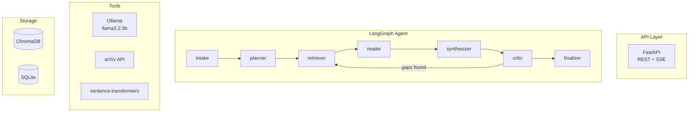

# Hive Lite

**Hive Lite is the first, lite version of the Knull agentic hive mind (AI Engineering 101, Ch. 15 "The Symbiote Swarm"). The full-fledged hive mind is coming soon.**

An AI-powered research hive that transforms vague research objectives into structured, citation-backed reports: Knull plans a task DAG, researcher symbiotes claim tasks with leases and fences, an independent verifier checks every claim against verbatim evidence, and a watchdog plus a hard token budget keep runaways in check. Built for **local execution on resource-constrained hardware** (MacBook Pro M2, 8GB RAM).

> **Note**: This project is not currently deployed as a hosted service. If you'd like to try it out, you're welcome to clone the repository and run it locally. The setup is straightforward and documented below. I'd appreciate any feedback or suggestions.

## Development workflow

Start with the [beginner architecture guide](ARCHITECTURE.md), [eight-view visual atlas](docs/architecture/index.html), and [Knull swarm-control walkthrough](docs/architecture/knull.html). They explain current versus proposed behavior, module responsibilities and the phased implementation handoff. Open the HTML files locally in a browser; repository web previews may show their source.

External agents can use the optional [Hive MCP server](integrations/mcp/README.md): stdio or authenticated local HTTP, with Codex/Claude Code setup examples and a remote GPT example. The adapter calls existing lite Hive APIs; modular skills/hierarchy remain proposed capabilities.

Explore current source through [the codebase knowledge graph](docs/knowledge-graph.md): [interactive map](graphify-out/graph.html), [report](graphify-out/GRAPH_REPORT.md), and [JSON](graphify-out/graph.json). Static code coverage and freshness limits are documented in the guide.

This repository uses **spec-driven development with Superpowers**: understand → specify → review → plan → implement → verify. Start with [the development workflow](docs/DEVELOPMENT.md) and [the spec index](docs/superpowers/README.md). Agent instructions live in [AGENTS.md](AGENTS.md); Claude uses [CLAUDE.md](CLAUDE.md) as its entry point.

The [architecture review](docs/reviews/hive-modularization-review.md) supplies evidence and proposed fixes for the modular hive. [HIVE-MOD: modular task-based hive](docs/superpowers/specs/2026-10-19-modular-hive-design.md) links the proposed runtime, resource, Jev and hierarchy specs. [HIVE-001: evidence isolation](docs/superpowers/specs/2026-10-19-evidence-isolation-design.md) scopes the first provenance repair. Track actual remediation in [the problems/fixes register](docs/reports/problems-and-fixes.md). Future architecture and draft specs describe proposed behavior, not capabilities already shipped.

---

## The Problem: Why Traditional RAG Falls Short

Traditional Retrieval-Augmented Generation (RAG) systems follow a simplistic pattern: retrieve documents, stuff them into context, and generate a response. This approach suffers from critical limitations in research-intensive tasks:

1. **Single-Pass Retrieval** - Standard RAG retrieves once and hopes for the best. Complex research topics require iterative exploration—uncovering a relevant paper often reveals new subtopics worth investigating.

2. **No Critical Evaluation** - RAG blindly synthesizes retrieved content without assessing source quality, identifying contradictions, or recognizing gaps in coverage.

3. **Flat Knowledge Representation** - Documents are treated as isolated chunks. The semantic relationships between papers—citations, methodological similarities, conflicting findings—are lost.

4. **Context Limitations** - Stuffing all retrieved documents into a single prompt leads to context overflow and poor synthesis quality.

5. **Zero Observability** - Most RAG pipelines are black boxes. When output quality degrades, debugging is nearly impossible.

---

## The Solution: Agentic Architecture

This project reimagines research synthesis as a **multi-agent workflow** rather than a single retrieval-generation step. The system operates like a research team:

| Agent Node | Role | Advantage Over RAG |
|------------|------|-------------------|
| **Planner** | Decomposes topic into sub-queries | Systematic coverage vs. single-shot retrieval |
| **Retriever** | Multi-source search (arXiv, Semantic Scholar, Wikipedia) | Broader, more authoritative sources |
| **Reader** | Extracts key claims and methods per paper | Structured understanding vs. raw context stuffing |
| **Synthesizer** | Combines findings with proper attribution | Coherent narrative with citations |
| **Critic** | Identifies gaps, contradictions, weak coverage | Self-correction loop—retrieves more if needed |
| **Finalizer** | Produces structured report with all sections | Consistent, actionable output format |

### The Critical Differentiator: The Feedback Loop

The **Critic** node evaluates synthesis quality and can trigger additional retrieval rounds. This mimics how humans actually research: read papers, identify what's missing, search again. Traditional RAG cannot do this—it's strictly feed-forward.

---

## Core Capabilities

| Capability | Description |
|------------|-------------|
| **Multi-Agent Supervisor** | LangGraph workflow with 7 specialized nodes |
| **Multi-Source Retrieval** | arXiv, Semantic Scholar, Wikipedia integration |
| **Knowledge Graph** | NetworkX-based paper relationship mapping |
| **Semantic Cache** | Reduces redundant LLM calls by approximately 40% |
| **Local Observability** | Full execution tracing without external dependencies |
| **React Console** | Dark orchestration console on a Tailwind v4 design system (Geist type, lucide icons): task DAG, worker claims/leases, hive memory, budget, demo replay (no keys needed) |
| **Export Formats** | Markdown, PDF, BibTeX, JSON |
| **Trend Detection** | Identifies emerging research directions from metadata |

---

## Architecture



---

## Potential Impact

### For Researchers and Academics
- **Literature Review Acceleration**: Reduce weeks of literature survey to hours with automated gap analysis and contradiction detection.
- **Emerging Trend Identification**: Surface research directions before they become mainstream, enabling early positioning.

### For Industry R&D Teams
- **Competitive Intelligence**: Rapidly understand state-of-the-art in any technical domain without manual paper hunting.
- **Decision Support**: Get structured, citation-backed answers to technical feasibility questions.

### For the AI/ML Community
- **Reproducible Research Workflows**: Fully local, open-source stack eliminates vendor lock-in and ensures reproducibility.
- **Resource-Efficient AI**: Demonstrates that sophisticated AI workflows can run on consumer hardware (8GB RAM), democratizing access.

### Broader Implications
This project demonstrates that **agentic architectures fundamentally outperform monolithic RAG** for complex cognitive tasks. The patterns here—iterative refinement, self-critique, structured decomposition—apply far beyond research synthesis to any domain requiring systematic analysis.

---

## Quick Start

### Prerequisites

1. **Install Ollama**
   ```bash
   brew install ollama
   ```

2. **Pull the model**
   ```bash
   ollama pull llama3.2:3b
   ```

3. **Start Ollama server**
   ```bash
   ollama serve
   ```

### Installation

```bash
# Clone and enter directory
cd agentic_research_copilot

# Install dependencies
pip install -r requirements.txt

# Copy environment file
cp .env.example .env

# Create data directories
make dirs

# Start the API server
make dev
```

### Run the UI (optional)

```bash
make ui
```

Visit http://localhost:8501 for the Streamlit dashboard.

---

## API Usage

### Start Research

```bash
curl -X POST http://localhost:8000/v1/research \
  -H "Content-Type: application/json" \
  -d '{
    "topic": "transformer attention mechanisms and their variants",
    "depth": "normal",
    "constraints": "Focus on papers from 2023-2024"
  }'
```

Response:
```json
{
  "run_id": "abc123-...",
  "status": "pending",
  "message": "Research started..."
}
```

### Check Status

```bash
curl http://localhost:8000/v1/runs/{run_id}
```

### Stream Progress (SSE)

```bash
curl -N http://localhost:8000/v1/runs/{run_id}/stream
```

### Export Results

```bash
# Markdown
curl http://localhost:8000/v1/runs/{run_id}/export?format=markdown

# BibTeX
curl http://localhost:8000/v1/runs/{run_id}/export?format=bibtex

# PDF
curl http://localhost:8000/v1/runs/{run_id}/export?format=pdf -o report.pdf
```

### Submit Feedback

```bash
curl -X POST http://localhost:8000/v1/feedback \
  -H "Content-Type: application/json" \
  -d '{"run_id": "...", "rating": 5, "comment": "Comprehensive coverage."}'
```

---

## Report Structure

Every research run produces a structured report:

1. **TL;DR** - Three-bullet executive summary
2. **Background** - Context and foundational concepts
3. **Key Papers/Sources** - 5-10 papers with links and summaries
4. **Disagreements/Contradictions** - Conflicting findings across sources
5. **Gaps and Open Questions** - Identified unknowns in the literature
6. **Research Trends** - Emerging directions based on publication patterns
7. **Proposed Experiments** - Actionable next steps
8. **References** - Complete bibliography with links

---

## Testing

```bash
# Run all tests
make test

# Run specific test file
pytest tests/test_tools_arxiv.py -v

# Run with coverage
pytest tests/ --cov=app --cov-report=html
```

---

## Evaluation

```bash
# Run evaluation suite (20 golden prompts)
make eval

# Check results
cat eval/results.json
```

---

## Configuration

| Variable | Default | Description |
|----------|---------|-------------|
| `OLLAMA_BASE_URL` | `http://localhost:11434` | Ollama API URL |
| `OLLAMA_MODEL` | `llama3.2:3b` | LLM model |
| `OLLAMA_NUM_CTX` | `4096` | Context window |
| `EMBEDDING_MODEL` | `all-MiniLM-L6-v2` | Embedding model |
| `CHROMA_DIR` | `./chroma_data` | ChromaDB path |
| `SQLITE_PATH` | `./app_data/app.db` | SQLite path |

---

## Memory Footprint (8GB RAM Target)

| Component | Usage |
|-----------|-------|
| Ollama + llama3.2:3b | ~2.5 GB |
| sentence-transformers | ~200 MB |
| FastAPI + ChromaDB | ~300 MB |
| **Total** | **~3 GB** |

### Reducing Memory Load

1. **Use `depth: "quick"`** - Limits to 5 sources
2. **Set `OLLAMA_NUM_CTX=2048`** - Smaller context window
3. **Close Streamlit UI** - Saves approximately 150 MB
4. **Stop Ollama when idle** - `ollama stop llama3.2:3b`

---

## Project Structure

```
app/
├── main.py                 # FastAPI application
├── api/                    # API endpoints
├── core/                   # Config, logging, SSE
├── db/                     # SQLite models and repositories
├── agent/                  # LangGraph workflow
├── tools/                  # Ollama, arXiv, embeddings
├── intelligence/           # Knowledge graph, cache
├── traces/                 # Local observability
└── export/                 # Export formats

ui/
└── app.py                  # Streamlit dashboard

eval/
├── golden.json             # 20 test prompts
└── run_eval.py             # Evaluation runner

tests/
├── test_tools_arxiv.py
├── test_tools_vectordb.py
├── test_knowledge_graph.py
├── test_semantic_cache.py
└── test_api_research.py
```

---

## Known Limitations

1. **PDF Parsing** - Skipped for memory efficiency; uses abstracts only
2. **Rate Limits** - Semantic Scholar: 100 requests per 5 minutes
3. **Context Window** - 4096 tokens limits long document processing
4. **CPU Inference** - No GPU acceleration; slower but functional

---

## Troubleshooting

**Ollama not connecting:**
```bash
ollama serve  # Start the server
ollama list   # Check available models
```

**Out of memory:**
```bash
# Use smaller context
export OLLAMA_NUM_CTX=2048

# Use quick depth
curl -X POST http://localhost:8000/v1/research \
  -d '{"topic": "...", "depth": "quick"}'
```

**ChromaDB errors:**
```bash
# Reset the database
rm -rf chroma_data
make dirs
```

---

## Author

Built by [parth-6-5-4](https://github.com/parth-6-5-4)

For questions, issues, or contributions, please open an issue on [GitHub](https://github.com/parth-6-5-4/agentic_research_copilot).

---

## License

New releases use the custom [Knull Noncommercial Reciprocal License 1.0](LICENSE): noncommercial personal/development use is allowed; distributing or hosting modifications requires source sharing and upstream submission. Private unshared modifications may remain private. Commercial use requires separate permission. See [licensing notes](docs/LICENSING.md) for scope, prior MIT grants and third-party notices.

---

Built with LangGraph, Ollama, and FastAPI

---

## Lite Hive (Knull + symbiotes) and provider routing

Branch `hive-lite` adds a first, lite version of the "Symbiote Swarm" from *AI Engineering 101*, Chapter 15
(15.2 architecture, 15.4 memories, 15.7 failure table; rung 2 of the 15.8 build ladder: one orchestrator plus a few workers).

| Book role | Here |
|---|---|
| Knull (orchestrator) | `app/hive/agents.py::knull_plan` writes the task DAG: research_i -> verify_i -> write |
| Symbiote workers | researcher (reuses arXiv / Semantic Scholar / Wikipedia tools), verifier, writer |
| Claim table with leases | `app/hive/store.py`: atomic claim, attempt id, increasing fence, expiry; publish re-checks all of them |
| Hive memory | `facts` table: proposed -> verified / rejected, each with an evidence id and a verbatim quote |
| Verifier | separate context (sees only claim + evidence); non-verbatim quotes are rejected before any LLM call; fails closed |
| Watchdog / governor | plain code in `app/hive/watchdog.py` and `runner.py`: lease expiry requeue, attempt cap, loop detector, hard token cap |
| Final gate | findings sentences without a citation to a verified fact are removed; budget exhaustion returns `stopped`, never `done` |

Not in this lite version: lieutenants, human console / steering, 20-30 workers, broadcast/recheck on superseded facts,
long-term memory, process-crash replay across restarts of a live run (state is in SQLite but there is no resume command yet).

```bash
cp llm.example.yaml llm.yaml          # choose provider/model per layer and per agent
export OPENAI_API_KEY=... ANTHROPIC_API_KEY=... GEMINI_API_KEY=...
python -m app.hive.cli "Memory architectures for LLM agents" --workers 3 --budget 150000
# or via API: POST /v1/hive/runs {"objective": "..."}  then  GET /v1/hive/runs/{id}
```

**LLM routing.** All LLM calls (the original 7-node graph and the hive) go through `app/llm`. Resolution order is
`agents.<kind>` > `layers.<layer>` > `default`. Layers: `knull`, `workers`, `verifier`, `graph`. Agent kinds:
`planner`, `researcher`, `writer`, `verifier`, `synthesizer`, `critic`. Providers: `openai`, `anthropic`, `gemini` (official SDKs),
`ollama` (local), `mock` (tests). With no `llm.yaml`, everything still runs on local Ollama exactly as before.
`GET /health` shows the active routing and whether each routed provider has its key set (never the key).

Tests: `pytest` (62 tests, offline). SDK wiring is exercised against a local fake HTTP server; nothing here has been run against the live provider APIs.

---

## Console UI (React + TypeScript)

```bash
cd web && npm install && npm run dev        # dev server
npm run build                                # production build in web/dist/
```

The console talks to the FastAPI hive endpoints (`POST/GET /v1/hive/runs`). With no API keys or server,
open it with `?demo=1` to replay a recorded offline hive run: task DAG, worker claims, verified facts,
budget and the final report.

Stack: React 19 + TypeScript + Vite, Tailwind CSS v4 with a shadcn/ui-style semantic token system,
Geist/Geist Mono (bundled via Fontsource), lucide-react icons. Status is carried by colored dots and
badges, not node fills, so Knull's crimson accent never collides with error red.
# knull

## Hive storage upgrade and bounded execution

HIVE-001 uses schema version 1 with evidence keyed by `(run_id, id)`. Fresh databases initialize automatically. A recognized old hive database refuses normal startup until explicitly upgraded. Historical missing provenance stays inspectable but cannot enter new verified-memory reads or reports; migration does not copy another run's evidence or regenerate saved reports.

Stop **all** API, CLI and other hive writers before maintenance. Inspect first, then choose a new private backup destination:

```bash
python -m app.hive.migrate --db ./app_data/hive.db --check
python -m app.hive.migrate --db ./app_data/hive.db --apply --backup ./app_data/hive-before-v1.db
python -m app.hive.migrate --db ./app_data/hive.db --check
```

The command refuses unknown/custom schemas, NULL evidence keys, missing source files and existing backup destinations. It takes a consistent verified SQLite backup before the transactional rebuild; an already-v1 database is a no-op. Check evidence counts and `unresolved_facts_by_run` before/after. Restart writers only after validation. On failure, retain source and backup for inspection; there is no automatic restore. Restore a pre-upgrade backup only with writers stopped and confirmation that no accepted post-upgrade writes would be discarded. Otherwise retain current data and use forward repair. These commands were exercised on disposable fixtures; this task did not migrate your database.

HIVE-002 renews active leases, rejects stale mutations, propagates required-dependency failures and supervises worker/watchdog cleanup. Task deadlines apply across retries within one lite process; run deadlines include planning. Defaults: task 600 seconds, run 1,800 seconds. Configure through API fields `task_timeout_s` / `run_timeout_s`, or CLI:

```bash
python -m app.hive.cli "Compare public research approaches" --task-timeout 600 --run-timeout 1800
```

Verifier outages remain execution failures rather than factual rejection. Hive owns router-level retries. Actual shared token/cost reservation, unknown external-call settlement and cross-run capacity controls remain HIVE-004. Cancellation cannot forcibly stop an underlying synchronous SDK thread; its late result cannot commit, and CLI shutdown may wait for it. Durable restart/resume remains HIVE-006. See the [implementation evidence](docs/reports/hive-integrity/summary.md).
