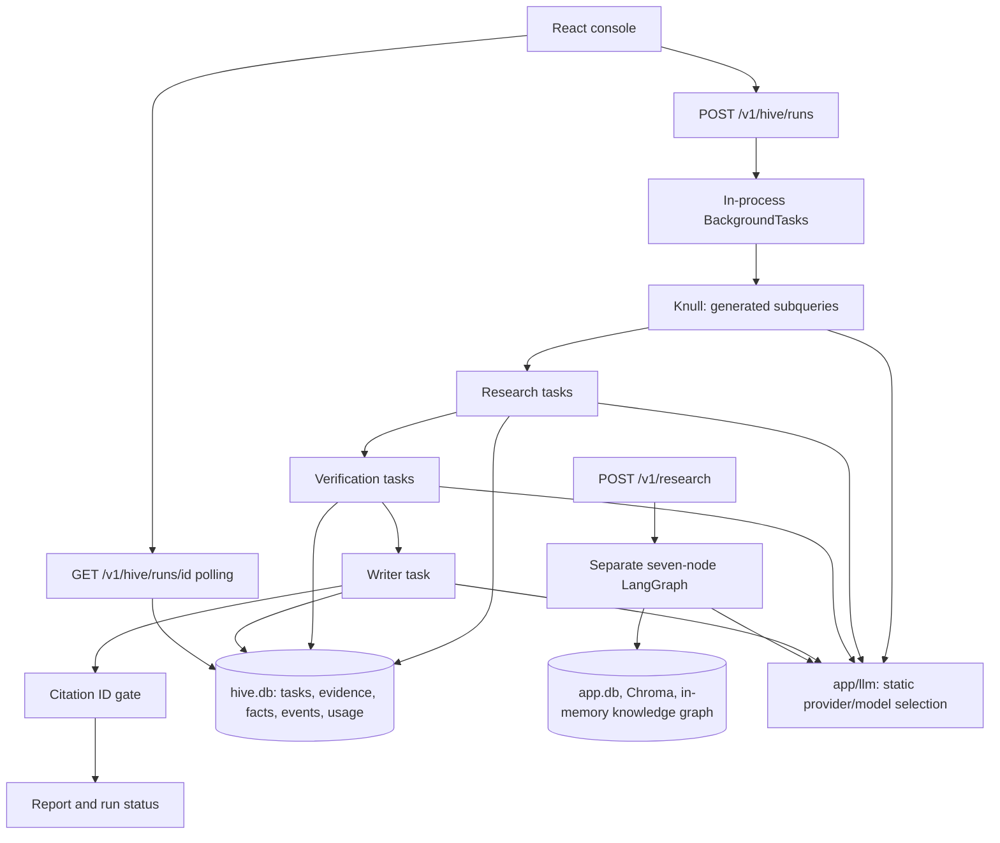
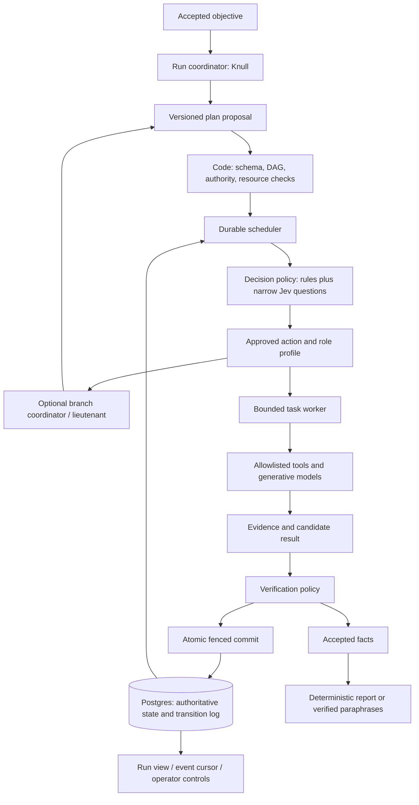

# Hive Lite: architecture review and modularization proposal

Reviewed 2026-10-19, Asia/Kolkata. Scope: current Python orchestration, persistence, verification, model routing, API/console contract, tests and evaluation. Runtime code remains unchanged. Proposed architecture is project-specific; it is not a description of Stripe's internal systems.

## Assessment

This is a useful research prototype with unusually concrete lease and evidence safeguards. It is still a fixed research workflow: a planner creates a small DAG, and a fixed number of interchangeable coroutine workers execute three hard-coded task kinds. Scaling requires durable execution semantics and explicit authority before additional hierarchy or workers.

Recommended next architecture: one modular application, Postgres-backed execution, bounded worker processes, optional branch coordinators, and a distinct Jev decision interface. Keep research as the first supported task family. Expand capabilities only after the same task/attempt/evidence contracts work through restart and concurrent execution.

Skills applied: Matt Pocock's `codebase-design` (deep modules, justified seams, interface-level tests) and `domain-modeling` (task/role/worker terminology); `stripe-engineering`, `stripe-agentic-delivery`, and `stripe-testing-rigor` (distributed-state invariants, bounded autonomy, failure-oriented verification).

## Current flow

There are two independent orchestration paths sharing retrieval tools and the LLM transport:



| Module | Behavior today | Implication |
|---|---|---|
| `app/hive/runner.py:29` | Plan, insert research → verify → write tasks, spawn N coroutines, run watchdog, finalize | Fixed task family and fixed topology; worker count is not a hierarchy |
| `app/hive/store.py:110` | SQLite transaction claims ready tasks; publish checks owner/attempt/fence/expiry | Valuable existing correctness mechanism; preserve it in any migration |
| `app/hive/agents.py:103` | Retrieve title/abstract text; extract claims and matching quotes | Hive evidence currently covers title/abstract content, not full papers |
| `app/hive/agents.py:157` | Separate-context LLM checks claim entailment against evidence | Entailment is already attempted; reliability has not been measured |
| `app/hive/agents.py:193` | Check citation IDs in output text | Establishes citation membership, not semantic support |
| `app/llm/config.py:44` | `agents[role] > layers[layer] > default` | Static configuration, not task classification or runtime routing policy |
| `app/agent/graph.py:546` | Separate LangGraph with rule-based supervisor; compile without checkpointer | Separate lifecycle, quality gates, state and recovery behavior |
| `eval/run_eval.py:16,113` | Calls legacy `run_research`; scores headings and citation counts | Existing golden set does not establish hive or layer/provider decision accuracy |
| `web/src/data.ts` | Polls hive API every 1.5 seconds; demo uses richer recorded data | Demo success is not evidence that live API contract works |

Preserve: injected search function; real provider adapters; mock provider; atomic result/evidence/fact publication; lease fences; verification context separation; refusal to publish uncited prose; route-level usage records. Deepen around these behaviors instead of replacing them wholesale.

## Your four examples, checked against source

| Concern | Current evidence | Required correction / fix |
|---|---|---|
| Crash-resume | API/CLI use file-backed SQLite; tasks, facts and events already persist. Default direct `run_hive()` uses memory. Execution lives in API background task. | Missing recovery protocol, not simply missing storage. Persist immutable plan/config and scheduler state; resume existing task state without replanning; reclaim leases; reconcile uncertain calls. Postgres enables multi-process execution but does not supply resume automatically. |
| Quotes vs misreading | Normalized substring check exists, followed by an explicit entailment prompt at `agents.py:146–175`. | Improve and evaluate existing semantic verifier. Add high-impact independent review and verify final prose against facts; distinguish contradiction, unsupported evidence, uncertainty and infrastructure failure. |
| Few workers | Default is three, API permits 1–8; direct CLI/function lack equivalent validation. | Bound concurrency across runs, providers and branches. Reserve resources before calls, cap context/output, and stress-test contention. Merely changing worker count does not exercise distributed races. |
| Mixed providers | Static overrides and fake-SDK wiring tests exist; no per-layer quality comparisons. | Build held-out fixtures per role and decision type; pin provider/model/prompt/rubric/config, promote from quality/cost/latency evidence, and preserve an evaluated fallback. |

## Defects to fix before increasing autonomy

P1 means blocks reliable scaling or allows a materially wrong result. P2 means a required capability or operational gap. No claim of an active production incident.

| ID / priority | Failure and evidence | Concrete fix | Acceptance oracle |
|---|---|---|---|
| F1 / P1 | **Repeated sources disappear from later runs.** `evidence_id()` hashes URL/source into a global ID; `evidence.id` is a global primary key, but verifier reads by run. `INSERT OR IGNORE` silently drops later run's source. Probe: first run verified 2; second run using same store verified 0, rejected 2, evidence rows 0. `agents.py:41`, `store.py:28,163,231`. | Short term: run-scoped evidence keys with matching foreign keys. Durable design: immutable content-hashed snapshots plus run-to-snapshot links. Do not overwrite previous evidence when a URL changes. | Two runs sharing a source both verify; changed text at one URL produces distinct snapshots; each fact resolves to its authorized snapshot. |
| F2 / P1 | **Permanent failure hangs run.** Exhausted research task blocks verify/write; `open_tasks()` counts them forever. Probe reaches 3 attempts, then timeout with run still running. `runner.py:59–63,85`, `store.py:119,252`. | Propagate prerequisite failure to blocked/skipped descendants; detect no-progress state; decide partial-result policy; finalize once no runnable/in-flight work exists. Add run deadline and structured cancellation cleanup. | Permanent tool failure reaches terminal run state within deadline; no dangling watchdog or pending orphan descendants. |
| F3 / P1 | **Final text can change a fact and reuse its valid citation.** Probe: “Caching increases calls by 900% [F-aaaaaaaa]” passes when cited fact says reductions of 40%. Headings bypass checks; sources are appended after gate. `agents.py:193–225`. | Prefer deterministic rendering of accepted claim text, with model allowed to choose IDs/order/grouping. If paraphrasing is required, verify each atomic final claim against the exact cited fact/evidence snapshot, including headings. Require at least one accepted finding before success. | Reversed relationship, swapped entity/number, overgeneralization, fabricated citation, heading claims and empty findings fail. |
| F4 / P1 | **Advertised hard budget is an admission check on past usage.** Calls check exhausted, await model, then book successful response. Probe: cap 100, two concurrent calls spend 400. Failures/ambiguous timeouts and provider-internal retries may be unrecorded. `agents.py:27–33`, `watchdog.py:27`, `llm/router.py:147`. | Atomically reserve conservative input + bounded output before dispatch; settle usage by durable call ID; retain uncertain reservations until reconciled; one retry owner. Enforce per-task/branch/run/global quotas and separate money from tokens. For providers without a trustworthy upper bound, describe cap as soft or refuse that route under hard-budget policy. | Concurrent admissions cannot exceed reserved allowance; unknown usage cannot reopen spend headroom; all attempts have ledger records. |
| F5 / P1 | **Fencing is incomplete.** Successful publication is fenced; `mark_exhausted()` unconditionally overwrites task by ID. Probe: a stale failure changes successfully completed task to exhausted. Expiry and heartbeat also use read-then-write outside a shared database transaction. `store.py:142,202–221`, `runner.py:85`. | Make every attempt-owned mutation a transactional conditional update on status, attempt, fence, owner and appropriate expiry. Reaper must compare captured fence/expiry; heartbeat must not resurrect expired/reassigned attempt. Run cancellation/status changes need version guards too. | Stale completion, failure, renewal, release and reaper cannot change newer attempt or completed state across separate DB connections. |
| F6 / P1 | **Live console contract mismatch.** API task objects omit `deps`; `HiveTask` requires it, and `DagView.tsx:32` executes `t.deps.forEach`. Demo includes deps. `routes_hive.py:56`, `web/src/types.ts:2`. Static source finding, browser reproduction not run. | Versioned typed response including deps and authoritative current worker/lease state; generated/shared schemas plus contract test. Return evidence/gate details needed to inspect trust. | Actual POST/GET response renders live DAG with dependency edges; demo and live satisfy same schema. |
| F7 / P2 | **No safe restart or durable planner commit.** `run_id` parameter still triggers a fresh plan. Query-based research keys and position-based verification keys can bind old verification tasks to a different/new plan. Events are separate writes and omit full transition outcomes. `runner.py:34–52`, `store.py:53,84`. | Separate create/resume/replan commands; atomically persist versioned plan and tasks; durable scheduler lease; same-transaction transition events. Resume from committed state; replan is explicit versioned supersession with invalidation. | Kill after acceptance, partial planning, claim, result commit and finalization; same run resumes, completed work remains stable, no silent graph mutation. |
| F8 / P2 | **Slow tasks lose leases without renewal.** Heartbeat exists but runner never invokes it. No end-to-end task deadline; one provider request/retry chain plus per-fact verification can outlast lease. `runner.py:54–88`, `store.py:142`. | Supervised heartbeat per active attempt, task deadlines, cooperative cancellation on lease loss, bounded checkpointing for long verification batches. Stop accepting output after loss. | Task longer than lease remains valid while healthy; dead worker is reclaimed; late worker cannot publish or mutate state. |
| F9 / P2 | **No actual task-based role selection or hierarchy.** Worker branch is research/verify/else-write; unknown kinds become writers. No parent, capability registry or delegation authority. `runner.py:67–77`. | Typed task spec plus allowlisted role registry; unknown kinds reject. Separate parent ownership from dependencies. Bounded branch coordinators create validated child plans; workers execute only assigned capabilities. | New supported task kind needs handler/contract registration without editing scheduler dispatch; unknown kind never invokes writer. |
| F10 / P2 | **Capacity is per run only.** Each request starts another worker pool; SQLite claims scan pending and completed tasks; sync DB operations occupy event loop; no global fair admission or provider quotas. `routes_hive.py:38`, `store.py:117`. | Global bounded scheduler, per-provider request/token limits, branch/run fairness, queue bounds and backpressure. Indexed Postgres readiness query with short claim transactions. | Measured contention/queue-age/latency/cost remain within agreed envelope under multiple runs, outages and throttling. |
| F11 / P2 | **Model output promises are mostly prompt-only.** Research asks for ≤8 claims and ≤40-word quotes, but code does not enforce these; planner accepts weak shapes; duplicate queries can create repeated verifications. Verifier outage is stored as factual rejection. `agents.py:72–85,124–140,170`. | Strict typed plan/claim/verdict schemas with size/length caps, query/task deduplication and explicit semantic versus execution states. Preserve valid evidence as unassessed on transient failure. | Oversized/malformed plans and claims fail closed within bounded retries; outage cannot masquerade as contradiction. |
| F12 / P2 | **Unmeasured quality and version drift.** Golden evaluation exercises legacy path and report shape. Config is not snapshotted per run; global role overrides can cross hierarchy/legacy layers. Router retains unbounded in-memory call log. `eval/run_eval.py:16`, `llm/config.py:44`, `llm/router.py:137`. | Versioned run execution manifest; per-role/decision evals and explicit routing scope. Persist bounded call telemetry with task/attempt IDs. Model fallback must preserve task and evidence policy. | Replay identifies exact config/prompt/model/evidence; routing comparisons measure accuracy, selective coverage, cost and latency rather than headings. |
| F13 / P2 before shared deployment | **No caller isolation or operation identity.** Hive endpoints have no authentication, ownership filter or idempotency key; repeated POST starts repeated paid work. Current local prototype has no multi-user contract. `routes_hive.py:31–61`. | Before shared use: caller-scoped idempotency with request hash, authorization on every read/mutation, quota scope and audit. Keep current local-only scope explicit until then. | Retry returns same run; conflicting key reuse rejects; one caller cannot read/steer another caller's run. |

Additional operational gaps: source search errors are swallowed (`agents.py:46–55`), so “no evidence” and “all providers failed” look alike; API returns only last 50 events after loading all history; event rows exposed without cursor IDs; no pause/cancel/resume controls; health always says healthy even with unavailable dependencies (`main.py:108`). These become repairability problems at higher concurrency. Legacy Chroma retrieval has no run filter (`graph.py:313`); do not present it as tenant-isolated if unifying the two workflows.

## Jev: verified capabilities and proposed responsibility

Jev is TypeSafe AI's decision model. It evaluates supplied state with typed questions; it is not a generic label for any LLM judge. TypeSafe recommends atomic judgments combined in application code. [Official introduction](https://docs.typesafe.ai/introduction).

The HTTP contract is `POST https://api.typesafe.ai/v1/systemone` with `model`, `state`, and named `questions`; response contains named `answers`, resolved model and usage. Choice returns a selected option, distribution and confidence; Score rates ordered rubric levels; Noul returns a yes probability. Keep the structured response instead of squeezing it into `LLMResponse.text`. [API schema](https://api.typesafe.ai/openapi.json).

Choice/Score confidence summarizes the returned distribution; it is not an independent proof of correctness. Noul has no separate confidence field; values near 0.5 are uncertain. Select thresholds per question/risk using held-out project labels. Do not treat `confidence=0.9` as measured 90% task accuracy. [Confidence](https://docs.typesafe.ai/confidence).

As checked October 19, model docs list `jev-1.13.0` and `jev-1.14.0`; `jev-latest` points to 1.13 and `jev-preview` to 1.14. Both have default 64k request / 32k per-question limits. Prefer compact decision-specific state. Pin an explicit evaluated version and log resolved version. October 14 release announces upcoming alias movement; do not make correctness depend on aliases staying fixed. [Models](https://docs.typesafe.ai/models), [release](https://typesafe.ai/blog/jev-1-14).

TypeSafe documents 1.13 weaknesses in arithmetic, date comparison, indirection, irrelevant long state, adversarial content and option ordering. Its schema guarantees do not establish factual accuracy. Keep exact computation/permissions in code; include adversarial and option-order cases in evaluation. Recheck these risks on 1.14 rather than assuming unchanged or fixed. [Known limitations](https://docs.typesafe.ai/model-jaggedness/jev-1.13).

| Decision point | Jev question | Code-owned consequence |
|---|---|---|
| Intake | Choice among supported task families plus clarify/unsupported | Accept allowed family or request clarification; never invent capability |
| Role routing | Choice over eligible role profiles, plus defer | Select an evaluated role profile; code maps it to approved tools and model |
| Evidence selection | Score relevance for each retrieved candidate using explicit rubric | Filter/rank within context budget; retain original provenance |
| Claim assessment | Choice supported/contradicted/insufficient on one claim + local evidence context | Mechanical quote/span validation first; policy applies confidence and risk thresholds |
| Branch progress | Noul for one specific uncovered completion criterion | Code checks remaining resources, then permits bounded additional task proposal |
| Ambiguity | Uncertain distribution or explicit defer choice | Use approved fallback, gather evidence, or stop for review; log exact reason |

TypeSafe's citation cookbook already demonstrates string matching followed by a context-sensitive Choice verdict. Use it as an integration pattern, not evidence of accuracy on our research corpus; its published example is a small cached fixture from an older model. [Citation cookbook](https://docs.typesafe.ai/cookbooks/citation_check).

Jev should not create arbitrary DAGs, write reports, choose numerical budgets, grant permissions, decide lease validity, or bypass completion gates. Generative models propose plans and claims; deterministic policy validates them; Jev supplies narrow judgments only where semantics justify a model call. Skip Jev for obvious deterministic cases or when only one eligible route exists.

## Target hierarchy and data flow



Three logical levels maximum initially: Knull → optional lieutenant → specialist. This is an initial policy proposal, not a measured optimum. Simple research stays flat. A lieutenant is bounded coordination work on a branch, not a permanently running LLM conversation or authority to spawn unlimited descendants.

Task-based spinning means an eligible ready task creates a bounded execution context for its registered role. Reuse a bounded worker pool initially; distinguish a logical specialist invocation from an operating-system process or container. Later autoscaling can respond to ready-queue age and eligible demand, subject to global/provider ceilings. A new task must not automatically launch an unlimited new process or inherit the coordinator's full context/tools.

Run coordinator owns objective-level completion and branch allocation. Lieutenant proposes local decomposition, tracks unresolved criteria and returns branch outcomes. Specialists retrieve/extract/verify/write. Deterministic scheduler owns placement, concurrency, leases, retries, cancellation, budget reservations and legal state transitions. Verification policy owns acceptance. Jev adapter owns transport and typed decisions, never commits.

Example: “compare memory architectures” becomes branches for retrieval, consistency and recovery. Each branch receives explicit completion criteria and an inherited budget. Jev chooses an eligible research profile from supplied candidates. Workers retrieve and extract; verifier accepts/rejects/defers individual claims. Missing recovery evidence permits one bounded follow-up proposal if resources remain. Coordinator completes only when required branch outcomes and final claim gates pass. Killing a worker requeues its attempt; killing API does not destroy the run.

Parent-child relation means delegation/accountability. Dependency relation means readiness. A writing task can depend on facts from multiple branches without belonging to multiple parents. Child completion must not finish its parent automatically: aggregation policy checks required outcomes, unresolved claims and budget/deadline state.

## Deep modules and interfaces

These are module interfaces, not a request to create six network services. Ownership shown as proposed code responsibility; accountable human owners remain to be assigned.

| Module / proposed location | Small interface | Hidden behavior and invariants | Dependencies / test surface |
|---|---|---|---|
| Execution lifecycle / `app/orchestration/runtime.py` | `submit(request, operation_key)`, `control(run_id, command, expected_version)`, `inspect(run_id, cursor)` | Durable acceptance, resume vs replan, legal lifecycle, idempotency, termination | API/CLI share this seam. Test observable run outcomes and recovery. |
| Task execution / `app/orchestration/execution.py` | `execute(assignment, context) -> CandidateResult` | Role dispatch, scoped tool/context manifest, heartbeat, deadline and cancellation | Inject real provider/tool dependencies and deterministic fake adapters; unknown kinds fail. |
| Decision policy / `app/decisions/policy.py` | `decide(request) -> ActionOrDeferral` | Candidate eligibility, narrow typed questions, threshold policy, fallback, durable decision record and stale-input check | True external Jev adapter plus recorded/fake adapter. Test allowed actions and deferrals through policy interface. |
| Evidence/verification / `app/evidence/service.py` | `assess(candidate_claims, evidence_refs, policy) -> Assessments` | Quote spans, snapshot resolution, semantic verdicts, provenance, high-impact review, invalidation | DB-owned facts; injected Jev/LLM evaluators. Test claim/evidence/result relationships rather than prompt substrings. |
| Provider execution / extend `app/llm` | `generate(call_spec, context) -> GeneratedResult` | Approved route snapshot, one retry policy, provider limits, usage receipt/unknown outcome, pooled clients | Existing real provider adapters and offline fixtures make seam real. Contract tests plus sampled live qualification. |
| Durable repository / evolve `app/hive/store.py` | `claim`, `renew`, `commit_attempt`, `transition_run` | Locking, fences, dependency readiness, atomic state/events, reservation settlement | Real Postgres integration required for concurrency guarantees; SQLite is useful for local behavior, not proof of Postgres locking. |

Locality gain: callers no longer coordinate leases, spend and fact publication themselves. Leverage: API, CLI, coordinators and future task families use the same lifecycle and execution contracts. Avoid role subclasses, plugin frameworks or pass-through repository layers until there is a real variation to hide. Keep pure validation and aggregation in-process.

Illustrative contracts, not implementation:

```python
TaskSpec = {
    "id": "stable-task-id", "run_id": "run-id", "parent_task_id": None,
    "kind": "research", "role_profile": "academic-research-v1",
    "dependencies": [], "input_refs": [], "completion_criteria": [],
    "policy_version": "v1", "deadline": "...", "delegation_remaining": 0,
    "resource_allocation_ref": "branch-allocation-id",
}
Assignment = {"task_id": "...", "attempt_id": "...", "fence": 7,
              "worker_id": "...", "lease_expires": "...", "manifest_ref": "..."}
DecisionRecord = {
    "decision_id": "...", "task_id": "...", "task_version": 4,
    "candidate_ids": ["..."], "input_snapshot_hash": "...",
    "question_version": "...", "model_version": "...", "raw_answers": {},
    "policy_version": "...", "outcome": "defer", "reason_code": "uncertain",
}
```

Decision commit must revalidate task/plan version, allowed candidate set and remaining resources. A valid answer to stale input is not permission to apply an action. Keep Jev decisions separately auditable from generated prose.

High-impact claim policy should require independently prepared verification contexts and, where evidence supports it, different evaluator routes plus corroborating source material. Two questions batched into one Jev request are not two independent verifiers; two model votes can share the same error. Disagreement or insufficient evidence yields review/deferral. Measure joint false-accept rate before allowing agreement to trigger automatic acceptance.

## Durable state and recovery proposal

Start with transactional state plus append-only transition events, not full event sourcing. Current events are diagnostic history, not sufficient to rebuild every task/fact/usage transition. Full event sourcing would additionally require complete versioned events, deterministic reducers, snapshots, upcasters and replay oracles; no need to pay that cost to obtain crash-resume now.

Proposed durable entities: runs with immutable execution manifests; tasks; normalized dependency edges; attempts and leases; branch resource allocations; call reservations and usage records; evidence snapshots plus authorized run links; claims and versioned assessments; decisions; transition events. Add foreign keys, unique constraints and readiness/lease indexes. Snapshot objective, plan, role/tool manifests, provider/model versions, prompts and policies.

Task lifecycle: pending → ready → leased → succeeded; failed attempts return to pending only while retries remain. Final task outcomes also include failed, blocked and cancelled. Explicit coordinator tasks may wait for children without consuming a worker lease; aggregate child results transactionally. Run lifecycle distinguishes queued/planning/running/waiting/paused and completed/partial/blocked/stopped/failed/cancelled. Map legacy status names at the existing API seam until clients migrate.

Every accepted transition writes state and transition event in one DB transaction. If events later need delivery to another process/broker, add an outbox and idempotent consumer. Do not replay events by blindly repeating provider calls. Calls can run at least once across ambiguous failures; accepted task results must be deduplicated and fenced. Exactly-once external execution cannot be promised without provider cooperation.

For worker processes, use short Postgres claim transactions and `FOR UPDATE SKIP LOCKED` on eligible tasks, together with guarded updates and a per-run coordination lease/version. `SKIP LOCKED` is suitable for queue consumers, not a general consistent snapshot; do not use it alone to decide that an entire run is complete. [PostgreSQL SELECT documentation](https://www.postgresql.org/docs/current/sql-select.html).

Resume protocol: load committed manifest/plan; obtain coordinator authority; identify committed tasks and uncertain calls; reclaim expired leases; propagate failed prerequisites; reschedule eligible work; rebuild progress view; finalize by guarded transition. Completed facts/results remain stable unless an explicit new plan/evidence version invalidates them. Planned fact supersession must invalidate dependent decisions/reports and enqueue bounded rechecks.

Budget allocations are hierarchical, not independent counters: sum of child allocations must stay within parent allowance. Acquire per-call reservation before dispatch, settle after response, and retain uncertain spend conservatively. Token budgets control capacity; monetary budgets require provider/model-specific pricing snapshots and conservative accounting. Charge planner, Jev, verifiers, retries and writer to the same run and branch where applicable.

## Alternatives and trade-offs

| Option | Benefit | Cost / risk | Decision |
|---|---|---|---|
| Harden SQLite and keep one executor | Smallest local fix; sufficient for a single-process demo | Serial writer, fragile multi-process races, still need lifecycle/recovery | Phase 0 stabilization only |
| Modular application + Postgres + worker processes | Durable shared authority, small deploy surface, natural migration from current store | Must implement and test scheduler/reconciliation correctly | Recommended first scale step |
| Adopt durable workflow engine | Delegates timers, history and some recovery machinery | Workflow determinism/versions, operational dependency, activities still need idempotency and budgets | Evaluate if long-lived timers/complex coordination become dominant; compare with real spike before deciding |
| Independent microservices / unrestricted recursive agents | Independent deployment and arbitrary delegation | Network failure modes and authority/cost complexity before proven need | Reject for current stage |

Jev choice is also reversible: keep a deterministic/approved-model fallback behind decision policy, with separate calibration. Do not silently replace Jev with a chat model under the same thresholds. Hierarchy buys coordination only when branches have independently assessable outcomes; otherwise it adds tokens and failure paths.

## Agent controls for the proposed expansion

| Area | Present | Required before unattended broader capabilities |
|---|---|---|
| Allowed work | Academic retrieval, claim extraction, verification and writing | Allowlisted role/task/tool manifests with read-only public research as initial class |
| Excluded authority | No generic shell or deployment task in hive | Reject arbitrary role/tool creation, production writes, credential discovery and self-granted permissions |
| Execution isolation | Coroutines in API process | Separate worker process and scoped credentials; sandbox external-action/code tasks if later introduced; no production secrets/data by default |
| Context | Separate verifier context, untrusted-source prompt | Minimal evidence/task context, content provenance, adversarial tests; retrieved text cannot change permissions |
| Stops | Attempt cap, loop detector, post-usage budget check | Depth/fan-out/task-count limits, resource reservation, global concurrency, deadlines, cancellation and explicit deferral |
| Reviewability | Partial events and usage aggregates | Task/attempt/decision IDs, input/policy/model versions, artifacts, verdicts, rejected actions and uncertain calls |
| Human handoff | No steering controls | Review only when policy requires it: unresolved high-impact claims, denied capabilities, exhausted repair, consequential external action |

Stripe's published Minions design interleaves deterministic steps and agent work, scopes tools/context, and isolates execution. Those are published coding-agent practices; applying their control principles to this research hive is an adaptation. The local hive does not currently have Minions-style isolation. [Stripe Minions Part 2](https://stripe.dev/blog/minions-stripes-one-shot-end-to-end-coding-agents-part-2).

Caller-scoped request identity follows the same general principle as Stripe's idempotency contract: stable operation identity, persisted outcome and rejection of incompatible parameter reuse. The exact retention and concurrent-response policy should be designed for research runs. [Stripe idempotency](https://docs.stripe.com/api/idempotent_requests).

## Verification evidence obtained

| Check | Command / environment | Observed result | Limit |
|---|---|---|---|
| Hive tests | `DEBUG=false python -m pytest tests/test_hive.py -q` | 15 passed | Mock models/search; does not establish real model quality or distributed behavior |
| Full suite | `DEBUG=false python -m pytest -q`, current Anaconda Python 3.12.7, restricted sandbox | 55 passed, 10 failed, 3 setup errors | 10 embedding failures: installed sentence-transformers 2.2.2 incompatible with huggingface-hub 1.20.1. Three SDK setup errors: sandbox prevented binding loopback server. |
| SDK retry outside socket restriction | `DEBUG=false python -m pytest tests/test_llm_sdk_wiring.py -q` with execution escalation | 3 passed, 1 failed | OpenAI/Gemini fake-server roundtrips and missing-key test pass; Anthropic SDK absent. No live provider call. |
| Five gap probes | `python docs/reviews/reproduce_hive_gaps.py` | All five executed; observed F1–F5 | Small deterministic fixtures; stale exhaustion probe exercises store mutation directly, not a full multi-process race |
| Console | Source/response schema comparison | Missing `deps` contract established in source | No browser run or frontend build: frontend dependencies absent |
| Jev | Read current official docs, schema, release and limitations | API and relevant behavior verified from primary sources | No account-specific model discovery, live Jev calls, calibration or latency/cost measurements |

Initial pytest collection also failed because inherited `DEBUG=release` cannot parse as bool. Explicit `DEBUG=false` allowed collection. This is environment evidence, not a conclusion that an application code fix is required.

Current environment does not match requirements: sentence-transformers 2.2.2 is below declared minimum 2.7; LangGraph 0.0.55 is below declared 0.2 minimum; Anthropic is missing. Do not interpret this full-suite result as a clean-environment regression baseline. Establish a locked environment and rerun before shipping. README's “62 tests, offline” is stale: 68 collected here, some require embedding assets and loopback networking.

Reproduction script and JSON are adjacent to this report. Source digest manifest identifies reviewed files because this folder has no project Git checkout; Git resolves to the parent home directory with unrelated changes. No parent repository operations performed.

## Required verification before enabling scale

All rows below are proposed, not run. Suggested role owners must be assigned to actual people. Fast tests should be deterministic; quarantine only nonessential flaky checks with an owner/expiry. Mandatory integrity tests may not be silently quarantined. Fix flaky harnesses or block promotion.

| Risk / invariant | Fixture, oracle and expected failure | Planned command | Tier / expected cost | Suggested owner / cadence |
|---|---|---|---|---|
| Cross-run provenance / final claims | Same source across runs; changed source body; contradictory paraphrases; assert authorized exact snapshot and no unsupported retained claim | `pytest tests/contracts/test_evidence.py` | Local + every CI; seconds | Evidence owner / every change |
| Terminal progress | Permanent failure, malformed DAG, exhausted dependency, empty findings; assert terminal outcome and no orphan async tasks | `pytest tests/contracts/test_lifecycle.py` | Local + every CI; seconds | Runtime owner / every change |
| Fencing and durable commits | Real Postgres, separate processes/connections, controlled clock; interleave renew/reap/commit/stale failure; assert one accepted outcome and complete event transaction | `pytest tests/integration/test_task_store_postgres.py` | Mandatory CI; seconds–minutes | Runtime owner / every store change |
| Crash-resume | Process kill at transaction/call boundaries; restart API/scheduler/worker; assert stable plan/results and recovery within defined objective | `pytest tests/integration/test_run_recovery.py` | Mandatory CI; minutes | Runtime owner / every lifecycle change |
| Budget and retries | Concurrent calls, unknown usage, nested SDK retries, rate limits; assert reservation conservation and bounded attempts | `pytest tests/integration/test_budget_admission.py` | Mandatory CI; seconds–minutes | Provider owner / every call-path change |
| Hierarchy authority | Fan-out/depth cycles, unknown role, child budget inflation, unauthorized tool, cancelled parent; assert deny/deferral without side effect | `pytest tests/contracts/test_delegation.py` | Local + every CI; seconds | Runtime owner / every policy change |
| API/live console | Actual response schema and real rendered POST→GET→DAG→report, terminal error and review states | `pytest tests/contracts/test_hive_api.py`; `npm --prefix web run test:e2e` | CI; minutes | API/UI owner / every schema change |
| Jev routing/verification quality | Human-adjudicated held-out fixtures per question; adversarial evidence, negation/numbers/option permutations and long noisy state; measure false acceptance, deferral coverage, calibration and end-to-end outcome | `python eval/run_decision_eval.py --manifest <pinned-manifest>` | Release/scheduled; paid API minutes | Evaluation owner / model, prompt or policy changes |
| Layer/provider qualification | Fixed evidence and tasks per role; compare held-out quality, errors, p50/p95 latency and spend; evaluate fallback separately | `python eval/run_layer_eval.py --matrix <route-matrix>` | Release/scheduled; paid API minutes | Evaluation owner / route changes |
| Contention and overload | Real Postgres, fake variable-latency providers; 4/8/16/32 worker processes, multiple runs, crashes, 429s and restart; then bounded live canary | `python load/run_hive_load.py --workers 4,8,16,32 --runs 10` | Scheduled/release; minutes | Runtime/provider owners / scale step |

These test filenames/scripts are proposed work items and do not exist yet. Zero false accepts in a finite fixture is a useful regression gate, not proof of zero production error. Choose confidence/error/latency/recovery thresholds from product consequences and held-out evidence; no current throughput or quality SLO has been supplied.

Observe: queue age by role/run, ready/leased/blocked counts, lease renewal/expiry, stale write rejection, no-progress runs, retry cause, reserved/settled/unknown spend, provider 429s/latency, Jev decision distributions/deferrals, verifier disagreement, rejected final claims and time to recover. Use bounded/paginated event reads with stable cursors; keep secrets and raw sensitive context out of logs.

## Implementation sequence and rollout

1. **Stabilize lite behavior.** Fix F1–F6, validate CLI/direct arguments, enforce typed/size-bounded outputs, call heartbeats, propagate prerequisite failures and make final findings safe. Promote five audit probes to desired-behavior regression tests. Repair environment reproducibility separately from product bugs. Exit: new integrity cases plus live console contract pass.
2. **Extract lifecycle and persistence seam.** API/CLI share run lifecycle; persist immutable manifests and plans; add operation keys, resume/cancel and atomic transition log. Move run work out of web request process. Exit: process-kill recovery works with a single executor.
3. **Introduce Postgres worker execution.** New runs opt into versioned engine/store. Add guarded transitions, reservations, global/provider admission and real concurrent integration tests. Preserve current SQLite runs as legacy/read-only or finish/drain them; avoid copying active leases. If importing history, reconcile evidence/run links and quarantine unverifiable facts rather than invent source content. Exit: contention, recovery and budget oracles pass.
4. **Add Jev decision module in shadow.** Versioned questions, compact state, explicit eligible candidates, resolved model logging, replay fixtures and per-role quality evals. Existing policy remains authoritative. Compare 1.13/1.14 explicitly; select from local evidence, not newest label. Exit: agreed false-action/coverage/latency/cost targets on held-out data.
5. **Enable limited Jev routing, then bounded hierarchy.** Canary reversible routing decisions; kill switch returns new decisions to evaluated fallback. Add one optional branch-coordination level and a second real task profile. Exit: task registration extends capabilities without scheduler edits; budgets/permissions remain inherited and bounded.
6. **Increase concurrency from measured evidence.** Synthetic multi-process load and fault injection first, small live paid canary second. Choose capacity limits from queue latency, correctness and cost; do not equate 32 mock workers with 32-worker live readiness. Unify legacy research through the shared runtime only after contract/eval parity; avoid leaving a bypass around new controls.

Prefer per-run engine selection over live dual execution of paid calls. Shadow evaluation consumes its own bounded budget and cannot commit facts or spawn authoritative work. On rollback, stop new admissions to new engine, pause/drain its workers, retain durable state and reconcile uncertain calls. Do not switch an in-flight run back to an incompatible older state machine or erase its event/usage history.

Open product decisions for implementation: target simultaneous runs and worker hosts; allowed task families beyond research; high-impact claim definition; acceptable abstention/false-accept rates; deadline/recovery/cost targets; who reviews escalations; whether shared deployment is in scope. These do not block the review or the immediate lite bug fixes. They do determine capacity, routing thresholds and rollout gates.
