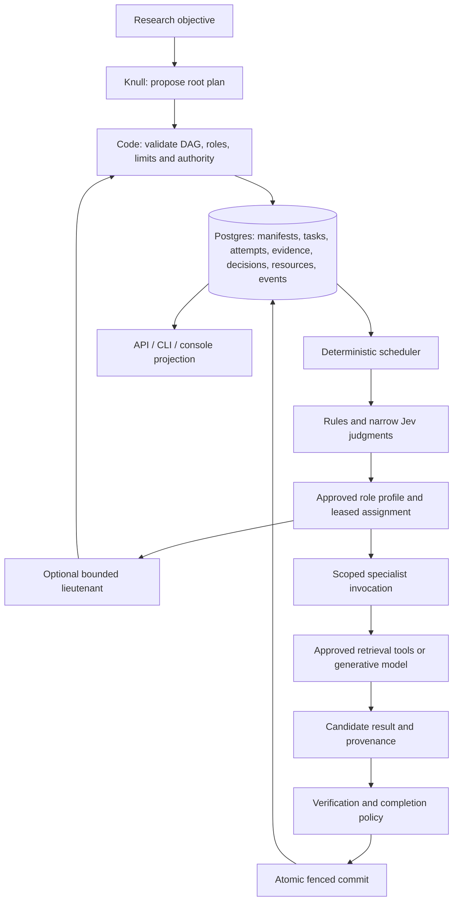

# Modular task-based hive design

**Spec ID:** HIVE-MOD
**Status:** Draft
**Date:** 2026-10-19
**Owner:** Project maintainer
**Approval:** Pending user review
**Depends on:** Linked delivery specs below
**Plan:** One plan per approved delivery spec; no whole-program implementation plan

## Intent and scope

The maintainer wants task-based agent spinning, a hierarchy, and Jev-based decisions/routing. A research objective should produce bounded specialist assignments, allow branch-level delegation where useful, and survive worker/API failure without losing accepted results or expanding authority/spend.

This is a specification task. It does not implement or approve runtime changes. The first release remains public-source research with registered planning, research, verification, coordination and writing capabilities. Generic shell agents, production writes, arbitrary downloadable plugins, unrestricted recursive delegation, tenant hosting and automatic provider purchasing are outside scope.

## Current behavior

`app/hive/runner.py` creates a fixed research → verify → write DAG and starts interchangeable coroutines. `app/hive/store.py` persists SQLite state and fences successful publication; not all mutations are fenced. `app/llm/config.py` statically resolves agent/layer/default. The API executes work in an in-process background task. Jev and branch coordinators do not exist in this path. [Audit and evidence](../../reviews/hive-modularization-review.md).

## Approaches

| Approach | Benefit | Cost | Proposal |
|---|---|---|---|
| Increase current coroutine count | Minimal change | Retains fixed dispatch, admission races, failure hangs and missing resume | Stabilization only |
| Modular application, durable scheduler, bounded workers, separate Jev policy | Reuses real capabilities behind small interfaces; shared durable authority | Requires state-machine and concurrency verification | Selected design for review |
| Workflow platform or distributed microservices immediately | Potential operational/recovery capabilities | More deployment/versioning machinery; external effects still need fencing and reconciliation | Revisit only after concrete runtime requirements justify migration |

## Architecture

The hierarchy is Knull → optional lieutenant → specialist. A logical specialist invocation uses a bounded worker pool; it is not a request to create an operating-system process for every task. Scheduler/resource policy controls physical concurrency. Jev chooses among permitted semantic options; it cannot allocate authority or commit a task.

## Delivery boundaries

| Spec | Owns | Integration prerequisites |
|---|---|---|
| [HIVE-001](2026-10-19-evidence-isolation-design.md) | Existing hive evidence isolation | First provenance repair |
| [HIVE-002](2026-10-19-execution-integrity-design.md) | Attempt fencing, failure propagation, renewal, termination | Required by durable runtime |
| [HIVE-004](2026-10-19-resource-governance-design.md) | Reservation ledger, concurrency, retries, inherited allocations | Required before distributed paid execution |
| [HIVE-006](2026-10-19-durable-runtime-design.md) | Durable lifecycle, contracts, Postgres, resume, API/CLI | HIVE-001/002/004 integration |
| [HIVE-007](2026-10-19-jev-decisions-design.md) | Typed decisions, candidate filtering, evaluation, fallback | Can build offline independently; authoritative integration needs runtime/resources |
| [HIVE-008](2026-10-19-role-hierarchy-design.md) | Role registry, task invocation, bounded branch delegation | Runtime/resources; Jev shadow mode before enabling semantic route selection |
| [HIVE-012](2026-10-19-skill-registry-design.md) | Repository skill packages, explicit registry, role bindings and immutable instruction/resource snapshots | HIVE-008 context seam; runtime/resource governance; optional Jev selection |

Existing backlog work remains necessary: HIVE-003 final-report support, HIVE-005 live console, HIVE-009 caller isolation, HIVE-010 typed assessments, HIVE-011 reproducible environment. Program completion includes their relevant gates; an unimplemented safety dependency cannot be bypassed merely because its spec is separate.

## Program requirements

| ID | Required outcome | Acceptance / owner |
|---|---|---|
| MOD-01 | Task execution varies through registered capabilities, without scheduler dispatch edits. | HIVE-008: exercise existing specialists and an additional registered fixture; unknown kind fails before execution. |
| MOD-02 | Root/branch/specialist responsibilities and inherited authority stay separate. | HIVE-008: cycle, depth, fan-out, task-count, tool and resource-inflation cases reject. |
| MOD-03 | Every accepted task outcome is durable and attributable to one valid attempt. | HIVE-002/006: kill/restart, stale-success/failure/reaper and duplicate commit tests. |
| MOD-04 | Jev decisions carry input/candidate/model/policy identity and may defer. | HIVE-007: stale, unavailable, uncertain and disallowed decisions cannot produce an authoritative action. |
| MOD-05 | All model/tool work fits admitted time, concurrency and resource limits. | HIVE-004: concurrent admission, unknown usage, retry and child allocation tests. |
| MOD-06 | Evidence and final findings preserve support across branches and retries. | HIVE-001 plus HIVE-003/010: repeated sources, missing provenance, contradictory prose and transient-verifier-outage cases. |
| MOD-07 | Operators can inspect actual task dependencies, hierarchy, attempts and decision causes. | HIVE-006 projection plus HIVE-005 contract/browser work; demo data alone is insufficient. |
| MOD-08 | Legacy and new execution remain distinguishable and recoverable during rollout. | HIVE-006: v1 unchanged, v2 additive, engine-pinned runs, drained rollback and preserved history. |
| MOD-09 | Promotion relies on observed quality/capacity evidence. | HIVE-007 held-out gates; HIVE-006 fault/load gates; HIVE-011 environment and HIVE-009 before shared exposure. |
| MOD-10 | Users can add reviewed local instruction packages without scheduler edits or authority expansion. | HIVE-012: discovery/registration, role eligibility, immutable snapshots, bounded loading and denied-tool fixtures. |

## Shared design rules

The durable runtime spec owns canonical task/run contracts and state names. Resource governance owns capacity and budget arithmetic. Hierarchy owns delegation validation and role manifests. Decision policy owns semantic selection and deferral. Evidence/assessment owns acceptance of facts. Callers use these module interfaces instead of duplicating their internal rules.

Use deterministic dispatch when only one eligible option exists. Models receive minimal task/evidence context and versioned instructions. Independent Jev questions are not independent verifiers. A typed or high-confidence judgment never overrides permissions, stale versions, exhausted resources or source provenance.

Use a versioned new-engine API and keep existing v1 entrypoints operating the lite engine. Public shared hosting is gated by caller isolation; initial operation is a trusted local deployment with public-source inputs. Deployment quantities and hierarchy defaults below are proposed initial configuration, not measured capacity claims.

## Rollout and validation

1. Repair integrity/provenance and define actual regression oracles.
2. Implement resource and durable-runtime contracts with deterministic fake providers; exercise real Postgres and process-kill recovery.
3. Add role registry and flat task-based execution; optional branches remain disabled.
4. Run Jev in shadow against fixed versioned fixtures and recorded candidates; no authoritative double execution.
5. Enable qualified reversible routing, then bounded branches; keep deterministic fallback and kill switch.
6. Run multi-process failure/load matrix before increasing worker/process limits or enabling shared deployment.

The scenario “compare memory systems across retrieval, consistency and recovery” must complete both flat and branch execution, expose supported findings, survive API/worker restart, reject a stale worker and stay within admitted resources. Report production quality, cost and latency only after live qualification. Mock acceptance establishes orchestration behavior, not research accuracy.

## Open decisions and review

Per-run hard ceilings below are deliberately configurable proposals. Actual workload/SLO, live auto-routing quality thresholds and high-impact-claim policy require owner selection before promotion, not before drafting offline modules. Those gates remain disabled without explicit policy values.

Self-reviewed 2026-10-19 for scope, ownership, dependencies and acceptance coverage. No runtime implementation, live-provider evaluation or user spec approval recorded. [Problems/fixes register](../../reports/problems-and-fixes.md).
