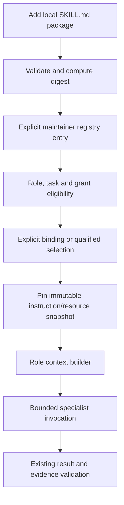

# Repository skill registry and task-scoped skill loading

**Spec ID:** HIVE-012
**Status:** Draft
**Date:** 2026-10-19
**Owner:** Project maintainer
**Approval:** Pending user review
**Depends on:** HIVE-008 role/executor seam; HIVE-004 resource accounting and HIVE-006 pinned manifests for authoritative execution; HIVE-007 only for optional semantic selection
**Plan:** Not written; requires spec approval

## Intent

Users should be able to add their own skills to this repository, register them without modifying scheduler code, and bind eligible skills to task-scoped agents. The operator must be able to inspect exactly which instructions/resources an invocation used. Changing a skill must not silently change a running or resumed task.

This adds reusable instruction packages to the proposed role system. A role defines executable capability and authority; a skill supplies task guidance within that role. A worker executes the invocation; a provider/model supplies generation. These are separate objects. A Markdown package does not itself create a tool handler, grant credentials, or make an unsupported task executable.

## Current behavior and evidence

The existing runner has fixed research/verify/else-write dispatch in `app/hive/runner.py`; prompts live in `app/hive/agents.py`. `app/llm/config.py` routes model calls, not skills. No product skill discovery, registration, loading, or binding interface exists. The host's installed Codex/Superpowers/Stripe skills guide development and are not a Hive runtime registry.

[HIVE-008](2026-10-19-role-hierarchy-design.md) proposes `RoleProfile`, tool allowlists, context builders and versioned invocation manifests, but no user-authored package contract. This spec owns that missing layer. Source inspection establishes absence; no skill runtime acceptance has been executed.

## Scope and alternatives

Initial scope: trusted local maintainer, repository-owned instruction packages, explicit registration, role binding, bounded resource loading, immutable run snapshots, CLI diagnostics and audit records. Existing built-in roles continue working without any custom skill.

| Option | Benefit | Cost / decision |
|---|---|---|
| Paste all skills into every agent prompt | Easy first prototype | Poor context isolation, no reproducible selection, unnecessary tokens; rejected. |
| Reuse standard `SKILL.md` packages with a Hive-owned registry and execution policy | Portable authoring; one role/context seam | Chosen. Host-specific permission metadata cannot be treated as runtime authority. |
| Dynamically import arbitrary Python/shell plugins from skill folders | Broad executable extension | Separate future trusted-code plugin design; excluded from this instruction-package release. |

No marketplace, automatic downloads, dependency installation, uploaded archives, executable skill scripts, server-side editing UI or shared tenant registry. An operator may review and copy an external package into the repo manually. This task does not alter global or installed third-party host skills.

## Author workflow and package format

Proposed repository layout:

```text
skills/
  source-comparison/
    SKILL.md
    references/
      comparison-rubric.md
hive.skills.yaml
```

Authoring steps: add package → validate syntax/resources → review content and permissions → record a version/digest in registry → bind to an eligible role → run offline fixtures → enable for selected new runs. Discovery alone never activates a package.

Use the [Agent Skills format](https://agentskills.io/specification): `SKILL.md` carries YAML frontmatter plus Markdown instructions; optional references/assets remain package resources. Validate required name/description, directory-name agreement, standard metadata types and documented length constraints. Hive's narrower execution restrictions below are project policy, not claims about what every Agent Skills host permits. The format's experimental `allowed-tools` field is not Hive's authorization mechanism.

Illustrative author content:

```markdown
---
name: source-comparison
description: Compare supplied academic sources on methodology and stated limitations.
---
Use only the task's supplied sources. Keep disagreements and missing evidence explicit.
Read references/comparison-rubric.md when comparing methods.
Return the role's existing result schema; include evidence references for each finding.
```

The registry is an explicit allowlist, not a directory of automatically executable modules. `hive.skills.yaml` has schema version 1 and entries with `id`, exact `version`, repository-relative `path`, expected bundle SHA256, `enabled`, `allowed_roles`, and `required_capabilities`. Additive metadata may record owner/license/source. Reject duplicate YAML keys, unknown security-relevant fields and unsafe YAML tags; load with safe parsing. A package's declared compatibility is descriptive; eligibility uses registered, machine-validated constraints.

The implementation plan must give the exact canonical digest algorithm and generated config example; it must not use dummy digest strings as accepted registrations. Identity is `(skill_id, version, bundle_digest)`. Same ID/version with changed bytes is a conflict requiring a new version. Paths resolve only under this repository's `skills/` root.

## Module interfaces and execution flow

The registry hides file/layout/version handling behind a small interface at the role context seam:

- `discover() -> list[SkillMetadata]`: bounded metadata inspection of local packages; distinguishes unregistered/disabled/invalid from eligible. No instruction execution, model call, download or script import.
- `validate(package_path) -> SkillValidation`: typed errors and computed digest; checks complete package constraints and referenced resources.
- `resolve(skill_id, version, expected_digest) -> SkillSnapshot`: immutable bytes/resource manifest, or typed unknown/disabled/conflict/incompatible error. No implicit `latest` for execution.
- `eligible(role_ref, task_capabilities, grants) -> list[SkillRef]`: code-owned filtering; results expose IDs/descriptions, not all package bodies.
- `load_resource(snapshot_ref, relative_path) -> bounded text`: reads only pinned, authorized resources from that snapshot; never arbitrary filesystem paths or URLs.

These are proposed interfaces, not currently importable functions. HIVE-008 resolves executable roles; this module resolves guidance. Typed registry errors occur before task/provider admission where possible and are represented as configuration/ineligibility outcomes, not factual rejection or successful task completion.



Bind skills to versioned role profiles or an explicit run recipe. An invocation records an ordered list of exact skill references. A task request cannot load an arbitrary path or add new registry entries. No role binding means no custom skill. Multiple eligible but unbound alternatives produce an explicit selection-required/defer outcome unless an operator-configured deterministic rule selects one.

Optional Jev selection follows HIVE-007: choose only from the currently eligible candidate list plus defer; revalidate grant/registry versions before binding. Singleton selection needs no model. Jev cannot register packages, add tools, grant capabilities or approve an unreviewed skill. Disabling Jev preserves explicit bindings.

## Context, resources and authority

Load metadata first, then selected instruction bodies, then only requested references. Record every loaded resource hash and byte/token accounting. Snapshot bytes before provider calls; never reread mutable live paths during a pinned invocation. Durable execution stores sufficient immutable bytes/references to replay under HIVE-006's retention/access policy; hashes alone cannot reconstruct a removed package.

Proposed initial ceilings: 100 registered skill versions, 100 regular files and 1 MiB per bundle, 16 KiB per `SKILL.md`, three activated skills per invocation and 64 KiB total loaded instruction/reference text. These are deterministic guardrails for review, not measured model capacity. Also respect the role/provider input-token ceiling and HIVE-004 reservation. Exceeding either ceiling rejects/defer before the call; never truncate away mandatory instructions silently.

Reject absolute paths, `..` traversal, symlinks, regular files with link count above one, device/FIFO/socket files, and path aliases/case collisions that undermine snapshot identity. Build snapshots from verified opened regular files and recheck metadata/digest to prevent file replacement between validation and read. Do not follow external links, load `.env`/credential files or execute scripts. `scripts/` may remain inert bundled material only if validation reports it as non-executable; a required executable dependency makes the skill ineligible in v1. Binary assets require an explicitly supported typed role loader; otherwise required binary content is unsupported, not silently omitted.

Skill-required capabilities must be a subset of the effective principal/parent/role/runtime grant. A skill cannot add authority. `allowed-tools` and prose are declarations, never execution grants. Native tools must enforce permissions independently of model instructions. No new generic shell/filesystem/network tool is introduced by this spec.

Compose skill bodies in manifest order under the role's governing contract. Deterministically reject incompatible declared schemas, mutually exclusive declared capabilities or allocation requirements. Semantic contradictions in free text cannot be proven absent by metadata validation; use reviewed bindings and offline evals, and defer ambiguous composition. Do not claim a prompt-precedence rule alone prevents injection.

Preserve verifier independence: only verifier-eligible skill snapshots, claim, authorized evidence and verification policy; no researcher conversation, private scratchpad or unrelated branch instructions. Each child obtains its own role-eligible skill binding; parent activation does not automatically propagate instructions or permissions.

## Requirements

| ID | Required behavior | Acceptance oracle |
|---|---|---|
| SKL-01 | User adds a standards-shaped package without scheduler edits. | New fixture package validates/discovers; existing unmodified scheduler invokes it through a registered role. |
| SKL-02 | Registration/activation is explicit and deterministic. | Unregistered/disabled package cannot activate; duplicate ID/version or malformed/unsafe config fails before any model/tool call. |
| SKL-03 | Version and content identity are immutable. | Changed bytes under a pinned version/digest reject; new version can coexist; a resumed task uses its original snapshot. |
| SKL-04 | Package/resource access stays inside the admitted snapshot. | Traversal, symlink/file-swap escape, special file and external URL fixtures fail without reading outside the permitted root. |
| SKL-05 | Skill instructions cannot enlarge authority. | Fake skill requests ungranted tool, credential access or delegation; deterministic tool/assignment admission denies it regardless of generated text. |
| SKL-06 | Role and skill eligibility remain separate from model selection. | Incompatible/unknown skill-role binding fails; changing generator provider does not add skills/tools or alter pinned resources. |
| SKL-07 | Context loading is progressive, bounded and accounted. | Unselected bodies/references absent from captured prompt; byte/token/file/skill ceilings enforce before provider execution, with explicit errors. |
| SKL-08 | Composition has a reproducible order and explicit conflict behavior. | Manifest order stable across restart; declared incompatible schemas/grants reject; unresolved semantic selection defers. |
| SKL-09 | Independent verification context remains isolated. | Research-only skill and parent conversation never appear in verifier prompt or accessible verifier resources. |
| SKL-10 | Selection is bounded and optional. | Explicit binding works with Jev off; singleton skips model; malformed/ineligible/stale Jev choice cannot activate a package. |
| SKL-11 | Lifecycle changes preserve accepted history and control future admission. | Normal disable affects new runs; pinned version retained for admitted tasks; emergency revocation blocks new calls using revoked digest without deleting accepted evidence/results. |
| SKL-12 | Operators can diagnose provenance and eligibility safely. | List/validate/explain show IDs, versions, digest, role eligibility and safe failure reasons; no credentials/full source text in routine event logs. |
| SKL-13 | Existing zero-custom-skill behavior remains compatible. | Built-in research/verify/write fixtures pass with absent registry or empty valid registry; unknown registry schema fails clearly if explicitly configured. |
| SKL-14 | Scripts and installation remain outside instruction activation. | Bundled script never imports/runs and dependencies never auto-install; required unsupported executable dependency returns ineligible. |

## Failure, lifecycle and recovery

Treat packages as maintainer-reviewed but untrusted model context. Metadata checks do not certify instruction quality or remove prompt-injection risk. Invalid packages remain discoverable as diagnostics but cannot execute. Missing pinned snapshot is an explicit recoverable configuration failure, not permission to substitute the newest package.

Registry edits publish a new registry revision atomically after full validation. If one entry is invalid, do not expose a partly accepted new revision; retain prior valid revision and report error. Explicit empty/absent configuration preserves built-in roles. An emergency denylist may revoke a compromised digest immediately; stop admission/cancel outstanding calls as far as the provider supports, preserve unknown/in-flight usage accounting, and retain accepted history. Revocation is not deletion or proof of remote cancellation.

Skill-context sizes consume the invocation's existing input budget; selection calls consume Jev/model budgets. No private background process or unbounded recursive skill loading. References cannot recursively activate other skills. V1 has no package dependency resolver; explicit bindings must list every activated skill within the three-skill limit.

## Compatibility, rollout and recovery

Develop loader/validator against fixture packages independently, then integrate at HIVE-008's flat role context seam. Initially require explicit binding; automatic selection remains disabled. Add one harmless instruction-only research fixture and compare captured prompts/results with the built-in baseline before enabling real packages.

Extend HIVE-006 run/invocation manifests with registry revision and skill snapshot references under a versioned schema. New mandatory skill fields require a new manifest schema; old manifests default to no custom skills only when they never declared a requirement. Do not pretend the present lite runner has this capability. A rollout can disable custom activation for new runs without deleting snapshots needed by existing runs.

CLI proposal: `skills list`, `skills validate PATH`, `skills explain ID@VERSION`, with exact entrypoint/JSON schemas finalized in the implementation plan. Maintenance commands do not write global host skill locations. A future MCP layer may expose bounded list/resource interfaces; it must reuse this registry rather than implementing separate authority/discovery rules.

## Verification and review

SKL-01/02/03/04/07/08/12/14: pure parsing plus real temporary filesystem snapshot tests, controlled file-replacement fixtures and size limits; no shell execution from packages. SKL-05/06/09/10/13: executor/context-builder contract tests with mock providers and denied-tool assertions. SKL-03/11: durable manifest, restart, disable/revocation and in-flight cancellation/accounting integration tests.

A fixture package must execute through an existing role without scheduler changes and show its exact digest in the invocation audit. A malicious fixture must fail the tool-permission oracle even if a model follows its prose. Live task-quality comparisons are a separate qualification stage; fixture success is not evidence that arbitrary community skills are safe or useful.

Self-review 2026-10-19: roles/skills/tools/providers separated; package identity, offline authoring, pinned resources, limits, grant enforcement, verifier isolation and recovery specified. No implementation or acceptance tests executed. No blocking design question for the initial instruction-only local registry; proposed ceilings require review before implementation. Executable plugins and shared hosting remain excluded.
