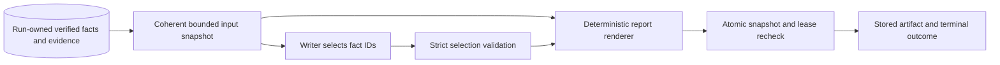

# Supported final findings and safe report construction

**Spec ID:** HIVE-003
**Status:** Spec approved
**Revision:** 1
**Date:** 2026-10-20
**Owner:** Hive maintainer
**Approval:** User approved revision 1 on 2026-10-20: “Approve revision 1; write the plan.”
**Depends on:** HIVE-001 provenance; HIVE-002 fenced publication and terminal failure handling
**Plan:** [Revision 1 implementation plan](../plans/2026-10-20-supported-reports.md), pending plan review and execution-method selection under [the development workflow](../../DEVELOPMENT.md)

## Intent

A report reader needs the final findings to state the claims actually accepted by the verifier. Today, a writer can reverse a number or relationship and reuse an accepted fact ID. The report still passes. Headings and even an empty findings body can also produce a successful run.

The proposed contract gives the model editorial selection and ordering, while deterministic code owns the wording, headings, citations and source list. For example, if the accepted claim is “Caching cut calls by 40%,” selecting its ID emits that exact claim. The writer cannot turn it into “Caching increased calls by 900%.”

“Supported” here means preserved from a run-owned, verifier-accepted claim with its evidence snapshot. It does not mean universally true. A mistaken original verification remains possible; semantic verifier evaluation and high-impact independent assessment remain separate work.

## Current behavior and evidence

Current source was inspected on 2026-10-20; source hashes and observed results are in [the baseline JSON](../../reviews/2026-10-20-hive-003-baseline.json). Reproduce with [the offline probe](../../reviews/reproduce_hive_reports.py):

```bash
DEBUG=false /opt/anaconda3/bin/python docs/reviews/reproduce_hive_reports.py
```

The probe uses mock providers and in-memory SQLite. It never opens real application data.

| Boundary | Observed behavior | Consequence |
|---|---|---|
| [Writer and gate](../../../app/hive/agents.py) | `final_gate` checks citation membership, without comparing the sentence to the cited claim. | Reversed/unsupported prose with valid IDs passes. |
| Same gate | All lines beginning with `#` bypass checks; empty input gives `passed=true`. | Unsupported headings and zero findings pass. |
| `run_writer` | Appends every verified fact's source after checking the body. | An empty body acquires a nonempty report and apparently supporting references. |
| [Run finalization](../../../app/hive/runner.py) | A completed writer and nonempty report string qualify for `done` or `done_with_removals`. | Heading-only and empty-body mocked runs both finish `done`, with two verified facts and zero checked sentences. |
| [Store](../../../app/hive/store.py) | HIVE-001 filters verified reads for run-owned evidence; HIVE-002 fences publication. Facts and evidence are currently read separately. | Preserve those safeguards; add a coherent report input snapshot and publication-time check. |
| Report metadata | Objective, source title/URL and claim text enter Markdown without a data-only encoding contract. | Raw HTML survives in the report string; generated content can supply structure. |

The HTML observation is string-level evidence. The React report consumer renders parsed Markdown without an explicit sanitizer by source inspection; no browser exploit was executed. Historical report display hardening is tracked separately as F3-D. This spec must not be described as securing that entire consumer.

## Scope and non-goals

Deliver one lite-hive reporting contract: bounded structured selection, deterministic rendering, scoped provenance, atomic publication validation, explicit failure outcomes and compatible report delivery through the existing API, CLI and MCP adapter.

No new database schema or real-data migration is proposed. No free-form report paraphrasing, summaries, conclusions or generated section titles are permitted in this version. No changes to legacy LangGraph, Jev, planner/researcher schemas, global budget admission, provider qualification, Postgres, restart/resume or historical report rewriting. UI sanitization of arbitrary saved reports is an adjacent tracked repair, not an implied result of backend escaping.

## Approaches and proposed choice

| Approach | Benefit | Cost / limitation |
|---|---|---|
| Render all accepted facts without a writer call | Smallest authority surface and lowest model cost. | Removes selection and relevance ordering; output can become repetitive. |
| **Model selects IDs; code renders accepted claims** | Preserves editorial selection while making wording preservation mechanically testable. | More extractive reports; no narrative synthesis. Recommended for this lite foundation. |
| Free prose followed by claim-by-claim semantic assessment | Supports narrative synthesis. | Additional calls, failure states and calibrated evaluation; a second model is not a deterministic proof. Defer to a separately qualified extension. |

The selection contract is reversible through a future versioned report policy. Stored Markdown remains readable. There is no fallback to the current prose/citation gate when selection fails.

## Requirements and invariants

| ID | Required observable behavior | Acceptance oracle |
|---|---|---|
| REP-01 | A report input snapshot contains only same-run verified facts with resolvable same-run evidence. Capture facts and sources coherently. | Foreign, missing, rejected and proposed facts cannot become selectable; injected missing provenance produces no supported finding. |
| REP-02 | Writer response is one strict JSON object with exactly `fact_ids`, an ordered array of unique strings. Reject duplicate object keys, unknown fields, trailing prose, code fences, wrong types and oversized responses. | Every malformed fixture yields an explicit selection error, no rendered report and no fact-status changes. |
| REP-03 | Every selected ID must belong to the supplied candidate snapshot. Unknown, duplicate or excessive selected IDs reject the whole selection. | One valid plus one forged ID never produces partial success. Empty selection has a distinct no-findings outcome. |
| REP-04 | Finding text comes only from the selected accepted claim; model prose never supplies report text. | Number swaps, reversed relations, changed entities, overgeneralizations and multi-citation laundering cannot introduce new wording. Rendered visible claim text matches its snapshot. |
| REP-05 | Code owns neutral headings and citation placement. All untrusted strings render as text; they cannot add headings, links, HTML, citations or additional findings. | Claims/objectives/source titles containing Markdown, HTML, newlines and fake citation markers remain literal data; only code-generated citations are active references. |
| REP-06 | Sources correspond exactly to emitted findings and their pinned evidence. Only validated absolute HTTP(S) URLs become links. | No unused sources, cross-run substitutions, script/data/file URLs, credentials, control characters or delimiter injection; unsafe URLs remain inert text with a recorded warning. |
| REP-07 | Successful completion requires at least one emitted finding. `gate.passed` is true only for a wholly valid nonempty report. | Empty selection, heading-only/prose responses, all-invalid candidates and empty claims cannot finish `done` or `done_with_removals`. |
| REP-08 | Publication atomically rechecks the active assignment and every selected fact/evidence identity and acceptance state against the snapshot. | Separate-store mutation or lease loss after selection prevents report/result/completion writes together; unchanged snapshot publishes once. |
| REP-09 | Report policy, ordered selected IDs, source identities, content digests, counts, warnings and machine-readable failure reasons remain inspectable in task/run result metadata. | A stored result can identify the exact accepted claim/source bytes used, without depending on current source URLs or model prose. |
| REP-10 | Candidate input, response and output sizes have code-enforced limits; failure never truncates or rewrites an individual accepted claim. | Boundary and one-over-limit tests distinguish deterministic candidate omission from invalid selection and oversized rendering. No extra semantic model calls occur. |
| REP-11 | Existing report-string API/CLI/MCP surfaces remain compatible; legacy saved reports remain unchanged. Writer policy changes explicitly, without a compatibility bypass to ID-only gating. | Route/CLI/adapter contract fixtures pass; historical Markdown can still be fetched byte-for-byte. |
| REP-12 | Provider/transport failure and invalid model output remain execution failures, distinct from lack of accepted findings or factual rejection. | Outage or malformed selection never rejects facts; HIVE-002 retries/deadlines terminate without a success report or orphan workers. |

## Interfaces and data flow

Terms local to this design:

- **Report input snapshot:** immutable candidate claim and evidence data captured for one writer attempt, identified by run/task/attempt/fence and policy version.
- **Selection:** ordered IDs proposed by the writer. It grants no permission and creates no new accepted claim.
- **Finding:** one selected accepted claim rendered with a code-owned citation.
- **Report artifact:** Markdown plus gate/provenance metadata produced from a validated selection and snapshot.



### Module ownership

- Proposed `app/hive/reporting.py`: one reporting module owns strict selection validation, bounds, text encoding, URL policy, deterministic rendering, metadata and typed errors. Keep these rules behind a small interface rather than spreading gate checks across caller code.
- `app/hive/agents.py:run_writer`: obtains the snapshot, makes the existing writer-route call, invokes reporting and returns the artifact to the executor. Preserve the existing `(report, gate)` public tuple where practical; the executor also needs the snapshot binding for commit.
- `app/hive/store.py`: captures a coherent read snapshot and publishes a report under one short write transaction. It owns assignment fencing and rechecking selected fact/source data. Reuse internal publication machinery, avoiding a weaker parallel completion path.
- `app/hive/runner.py`: maps no-findings versus failed execution, and finalizes using finding count and policy result. It does not infer support from report-string length.

Exact internal Python type names and method signatures belong in the approved implementation plan. The public data contracts below are design constraints.

### Selection and artifact contracts

The only accepted model response shape is:

```json
{"fact_ids": ["F-ab12cd34", "F-ef56ab78"]}
```

No grouping labels or free text. The writer sees only the objective as data and the bounded candidate list. Each ID appears once at most. A valid empty array means no selected findings; it is not a provider error.

Output uses fixed `# Research report`, `## Findings` and `## Sources` headings. The objective, if shown, appears as labeled literal text, never a generated heading. One finding is one accepted claim, followed by a code-owned citation. Sources are ordered to match selected findings; shared evidence may repeat under distinct fact references so each citation resolves without ambiguity.

Encoding must preserve visible text without interpreting embedded Markdown or HTML. Normalize CRLF/CR to LF only; preserve the remaining text as data, including literal citation-like substrings. Never silently cut a long claim, combine claims into a new assertion or trim away a negation. The implementation plan must select and test an encoding using the actual Markdown parser, including rendering-round-trip fixtures.

`gate` remains a JSON object and includes `policy_version: "accepted-claims-v1"`, `passed`, `finding_count`, `selected_fact_ids`, candidate/omission counts, bounded warnings and provenance. Provenance binds each selected ID to its accepted claim, evidence identity and SHA-256 content digests; the artifact retains the selected claim/source metadata needed to audit those hashes. Digests aid audit, not authorization. Do not duplicate raw evidence text into ordinary result/event payloads.

Retain existing `sentences` and `removed_uncited_or_unverified` compatibility keys during this policy transition, defined as rendered finding count and an empty list respectively; metadata marks that free prose was not accepted. Do not represent rejected selections as silently removed sentences.

### Proposed initial bounds

These are conservative code defaults for this report policy, not measured model context/capacity targets:

| Boundary | Proposed maximum / behavior |
|---|---|
| Candidate facts | First 32 eligible rows in stable fact-ID order; metadata records how many additional eligible rows were omitted. |
| Accepted claim / source title / source URL / objective | 4 KiB / 2 KiB / 4 KiB / 4 KiB UTF-8 respectively. Empty/whitespace-only claims fail input validation. |
| Complete serialized model input | 64 KiB UTF-8, including instruction and objective data. |
| Raw selection response | 4 KiB UTF-8 before parsing; at most 16 selected IDs. |
| Rendered Markdown | 128 KiB UTF-8. |

An oversized or malformed candidate within the chosen window fails input validation; do not silently remove part of its text or change fact status. An aggregate input/output bound failure emits a typed error before the relevant next step. Candidate-window omission alone is not a removal or execution error; it is visible in metadata. The model may select fewer than all candidates without implying that unselected facts were rejected. Full-store scan optimization and global token admission remain HIVE-004/006.

### Publication and consistency

Never hold a database transaction open during a model call. Capture the input snapshot, select/render outside transactions, then enter a short transaction that checks the HIVE-002 lease/worker/attempt/fence and the selected facts' current verified state, claim bytes and same-run evidence bindings/content. The report result and task completion commit in that transaction or neither does. An invalidated snapshot is an execution failure eligible for the existing bounded retry policy; it cannot publish the old artifact.

This guarantees support at report-task publication. Future revocation after publication requires the fact/report dependency invalidation protocol in HIVE-006; it is not retroactively solved here. Stored finalization copies the committed artifact without regenerating it. A later writer attempt cannot overwrite a completed artifact through an expired fence.

## Failure and resource model

| Condition | Required outcome |
|---|---|
| No eligible verified facts, or valid empty selection | No report; `passed=false`, `finding_count=0`, stable `reason` of `no_verified_facts` or `no_selected_findings`; run becomes `blocked` under current lite status vocabulary. No provider call when the candidate set is empty. |
| Invalid/oversized input or model selection | Typed writer execution error; no artifact publication or fact-status change. Existing bounded attempts may retry, then block dependent completion. |
| Provider failure, deadline or cancellation | Existing HIVE-002 execution handling; no fabricated no-findings or factual rejection. |
| Snapshot changed or assignment stale | Reject publication atomically. No partial report, result or completion write. |
| Unsafe source URL | Emit source label and inert escaped URL text, attach warning; valid supported findings can still complete successfully. Never dereference links during rendering. |
| Some candidates not selected | Valid successful report if at least one selected finding exists; record selection counts. No `done_with_removals` merely because editorial selection omitted candidates. |

The strict policy does not publish partial salvage from malformed responses. Existing `done_with_removals` remains readable for historical reports but is not produced by `accepted-claims-v1`. Bounded writer retries may make more than one call across attempts; there is no extra entailment pass within an attempt. Existing token accounting remains in force; atomic reservations and unknown-usage reconciliation are not claimed.

## Compatibility, rollout and recovery

Only new lite-hive writer attempts use this policy. Existing reports and the legacy graph remain untouched. Preserve existing Markdown report-string delivery in API/CLI/MCP. JSON gate remains available through CLI/direct results and stored task/run metadata; HTTP/MCP currently do not project a top-level gate, and this spec does not add that projection. Additional fields on existing gate surfaces are additive. Prompts and mock fixtures must change together, while adversarial prose fixtures remain as rejection tests.

Replace or retire `final_gate(report, verified_ids)`: an ID-only interface cannot establish this contract. Do not leave it as a supported safety API, silently extract IDs from old Markdown or fall back to free prose after JSON rejection.

No schema migration is expected: snapshots/provenance fit existing task-result and run-gate JSON fields. Existing running writers must be drained or restarted deliberately when switching policy; do not mix old prompt output and new validation within an attempt. If a necessary schema change emerges during planning, revise this design before implementation.

Observe writer failure reasons, finding counts, candidate omissions and publication rejections without logging sensitive raw model/source content. Abort rollout if zero-finding success, unsupported wording, unsafe generated markup, cross-run provenance or stale publication is observed. Recover through a corrected version and a new run; never enable the unsafe gate as an automatic fallback. Retain previous artifacts for diagnosis.

UI display of arbitrary historical reports remains unsafe by source inspection (F3-D). Backend output encoding does not substitute for a separately verified consumer sanitizer, nor justify a claim of end-to-end browser safety.

## Verification strategy

These are proposed acceptance checks, not executed passing tests. Observed defect evidence is the baseline above.

| Requirements | Cheapest trustworthy checks before delivery |
|---|---|
| REP-01, REP-08, REP-09 | File-backed SQLite tests with separate handles: snapshot/read coherence, changed/rejected/deleted selected fact or changed evidence, cross-run IDs, lease expiry/reclaim and all-or-nothing task publication. Reopen persisted results to verify provenance. |
| REP-02, REP-03, REP-10 | Table-driven pure contract tests for duplicate keys, types, extra fields, forged/duplicate IDs, empty arrays, byte/count limits, Unicode boundary cases and stable candidate windows. |
| REP-04–06 | Renderer tests for reversed relation/number/entity, overgeneralization, unrelated valid IDs, model-supplied headings/prose, empty/citation-only output, HTML/Markdown/newline injection, source mismatch and hostile URL schemes. Parse the resulting Markdown with the project's actual parser; verify visible claims and code-owned structure. |
| REP-07, REP-12 | Mock-provider full runs for good selection, no candidates, empty selection, malformed/oversized output, outages, deadlines, retries and stale publication. Assert terminal status, counts and unchanged fact statuses. |
| REP-11 | Focused hive tests, API and CLI report/gate contracts, existing MCP suite in its supported environment, and historical report read-back. Preserve the legacy path; run broader compatibility checks appropriate to touched shared code. |

Write meaningful failing regressions before runtime changes, then record RED/GREEN evidence and fresh review in the eventual plan/report. The baseline probe is diagnostic, not a replacement for acceptance tests. No paid live calls, model accuracy benchmark, load test or browser security verification has been performed for this draft. Known environment failures must remain explicitly classified rather than counted as passing.

## Open decisions

No unresolved technical choice blocks planning. User approved the extractive ID-selection policy, strict whole-selection rejection and initial explicit bounds in revision 1. Those bounds are policy limits, not a measured capacity or quality claim. Implementation-plan review and execution-method selection remain pending.

## Review record

- 2026-10-20 self-review: traced writer → gate → store publication → run finalization; reproduced false success and raw HTML retention using isolated mock runs. Distinguished claim preservation from verification accuracy and historical UI sanitization.
- Checked proposed status semantics, bounded inputs, snapshot race, old gate compatibility, no-real-data rollout and requirement/test traceability. Runtime implementation and acceptance tests remain pending.
- 2026-10-20 user review: “Approve revision 1; write the plan.” Revision 1 approved. Approval covers this design; it does not approve the subsequently written implementation plan.
- Linked implementation plan created and self-reviewed. Next stage: user plan review and execution-method selection. Application behavior remains unchanged by this documentation work.
- Planning clarification: corrected the description of existing HTTP/MCP gate projection after tracing the routes. No requirement or approved reporting policy changed; public surface compatibility remains REP-11.
